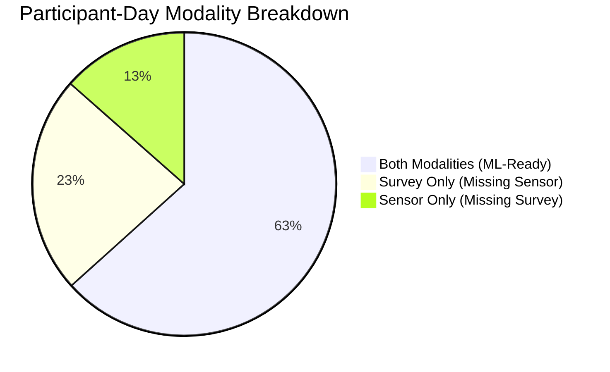

# StudySense Data Dictionary: `clean.daily_features`

## 1. Overview & Dataset Specification

The `clean.daily_features` table is the canonical, multi-modal machine learning dataset for the StudySense empathic system. It temporally aligns minute-by-minute passive wearable biometric signals (Fitbit Inspire 3) with active ground-truth ecological momentary assessments (EMA surveys) submitted by university students between February and July 2025.

- **Unit of Analysis**: One row per participant per calendar day (`participant_id`, `date`).
- **Primary Key**: `(participant_id, date)`
- **Foreign Key**: `participant_id` references `clean.participants(participant_id)`.
- **Target Table**: `clean.daily_features`
- **ML Training View**: `clean.v_ml_ready_daily_features` (`WHERE has_both_modalities = TRUE`)
- **Total Record Count**: 3,618 participant-days across 35 participants.
- **ML-Ready Complete Cohort**: 2,291 participant-days (both sensor features and self-reported labels present).

---

## 2. Table Schema & Column Dictionary

The table consists of **36 columns** divided into six logical domains:
1. **Identifiers & Temporal Keys** (2 columns)
2. **Physical Activity & Cadence Features** (8 columns)
3. **Autonomic Nervous System & HRV Features** (7 columns)
4. **Blood Oxygenation (SpO2) Features** (5 columns)
5. **Sleep Architecture Features** (2 columns)
6. **Passive Stress Estimates** (2 columns)
7. **Ground-Truth Emotional Labels** (7 columns)
8. **Modality Presence & Missingness Flags** (3 columns)

---

### Domain 1: Identifiers & Temporal Keys

| Column Name | PostgreSQL Type | Nullable | Engineering Unit | Source File | Derivation / Processing Rule | Description |
|---|---|---|---|---|---|---|
| `participant_id` | `SMALLINT` | **NO** | Categorical ID (`1`–`35`) | Folder name `data/raw/SSAQS dataset/{id}/` | Extracted from folder path and cast to integer. Foreign key to `clean.participants`. | Unique de-identified identifier for each enrolled student. Slicing key for GroupKFold train/test splits. |
| `date` | `DATE` | **NO** | `YYYY-MM-DD` (UTC) | All CSV timestamps | `timestamp::date` or `scheduled_at::date` across the union of all measurement dates. | Observation calendar date. Serves as the temporal alignment boundary. |

---

### Domain 2: Physical Activity & Cadence Features

| Column Name | PostgreSQL Type | Nullable | Engineering Unit | Source File | Derivation / Processing Rule | Description |
|---|---|---|---|---|---|---|
| `total_steps` | `INTEGER` | YES | Steps | `steps.csv` | `SUM(step_count)::INTEGER` across all minutes of the day. | Cumulative step count recorded by the triaxial accelerometer over 24 hours. |
| `mean_steps_per_min` | `NUMERIC(6, 2)` | YES | Steps / minute | `steps.csv` | `ROUND(AVG(step_count), 2)` across recorded minute epochs. | Average cadence across all sampled minutes throughout the day. |
| `max_steps_per_min` | `INTEGER` | YES | Steps / minute | `steps.csv` | `MAX(step_count)::INTEGER`. | Peak physical movement intensity. Cadences > 200 steps/min represent aerobic exertion. |
| `active_minutes` | `INTEGER` | YES | Minutes | `steps.csv` | `COUNT(*) FILTER (WHERE step_count > 0)::INTEGER`. | Number of minutes during the day where non-zero steps were logged. |
| `sedentary_minutes` | `INTEGER` | YES | Minutes | `activity_level.csv` | `COUNT(*) FILTER (WHERE activity_level = 'SEDENTARY')::INTEGER`. | Total minutes spent sitting, resting, studying at a desk, or sleeping. |
| `lightly_active_minutes` | `INTEGER` | YES | Minutes | `activity_level.csv` | `COUNT(*) FILTER (WHERE activity_level = 'LIGHTLY_ACTIVE')::INTEGER`. | Total minutes of casual walking, moving around campus, and light physical activity. |
| `moderately_active_minutes`| `INTEGER` | YES | Minutes | `activity_level.csv` | `COUNT(*) FILTER (WHERE activity_level = 'MODERATELY_ACTIVE')::INTEGER`. | Total minutes of brisk walking, active commuting, and moderate aerobic effort. |
| `very_active_minutes` | `INTEGER` | YES | Minutes | `activity_level.csv` | `COUNT(*) FILTER (WHERE activity_level = 'VERY_ACTIVE')::INTEGER`. | Total minutes of high-intensity physical training, running, and vigorous sport. |

---

### Domain 3: Autonomic Nervous System & HRV Features

| Column Name | PostgreSQL Type | Nullable | Engineering Unit | Source File | Derivation / Processing Rule | Description |
|---|---|---|---|---|---|---|
| `mean_rmssd` | `NUMERIC(8, 3)` | YES | Milliseconds ($ms$) | `hrv.csv` | `ROUND(AVG(rmssd) FILTER (WHERE is_valid_rmssd), 3)`. | Root Mean Square of Successive RR Differences averaged across 5-minute rolling windows. Primary biomarker of parasympathetic vagal activity. Excludes 10 zero-RMSSD optical artifacts. |
| `min_rmssd` | `NUMERIC(8, 3)` | YES | Milliseconds ($ms$) | `hrv.csv` | `MIN(rmssd) FILTER (WHERE is_valid_rmssd)`. | Lowest valid 5-minute RMSSD observed during the day, indicating peak autonomic stress or physical fatigue. |
| `max_rmssd` | `NUMERIC(8, 3)` | YES | Milliseconds ($ms$) | `hrv.csv` | `MAX(rmssd) FILTER (WHERE is_valid_rmssd)`. | Highest valid 5-minute RMSSD observed during the day, indicating parasympathetic rebound and relaxation. |
| `mean_coverage` | `NUMERIC(5, 3)` | YES | Ratio (`0.0`–`1.0`) | `hrv.csv` | `ROUND(AVG(coverage), 3)`. | Proportion of clean, artifact-free beat-to-beat intervals detected by PPG in each 5-minute window. Values > 1.0 (max 1.056) flagged as sampling overcount. |
| `mean_low_frequency` | `NUMERIC(10, 3)` | YES | Power ($ms^2$) | `hrv.csv` | `ROUND(AVG(low_frequency), 3)`. | Spectral power in the Low Frequency band (0.04–0.15 Hz), reflecting sympathetic-parasympathetic baroreflex interaction. |
| `mean_high_frequency`| `NUMERIC(10, 3)` | YES | Power ($ms^2$) | `hrv.csv` | `ROUND(AVG(high_frequency), 3)`. | Spectral power in the High Frequency band (0.15–0.40 Hz), reflecting respiratory sinus arrhythmia and vagal modulation. |
| `hrv_reading_count` | `INTEGER` | YES | Reading count | `hrv.csv` | `COUNT(*)::INTEGER`. | Total number of 5-minute HRV measurement epochs recorded during the day. |

---

### Domain 4: Blood Oxygenation (SpO2) Features

| Column Name | PostgreSQL Type | Nullable | Engineering Unit | Source File | Derivation / Processing Rule | Description |
|---|---|---|---|---|---|---|
| `mean_spo2` | `NUMERIC(4, 1)` | YES | Percentage (%) | `oxygen.csv` | `ROUND(AVG(spo2_percentage), 1)`. | Mean peripheral capillary oxygen saturation measured during rest or sleep. |
| `min_spo2` | `NUMERIC(4, 1)` | YES | Percentage (%) | `oxygen.csv` | `MIN(spo2_percentage)`. | Minimum recorded SpO2 value. Values < 70% are flagged as optical disconnect artifacts. |
| `max_spo2` | `NUMERIC(4, 1)` | YES | Percentage (%) | `oxygen.csv` | `MAX(spo2_percentage)`. | Maximum recorded SpO2 value (upper bounded at 100.0%). |
| `spo2_reading_count` | `INTEGER` | YES | Reading count | `oxygen.csv` | `COUNT(*)::INTEGER`. | Total count of minute-level pulse oximetry readings recorded. |
| `artifact_spo2_count` | `INTEGER` | YES | Reading count | `oxygen.csv` | `COUNT(*) FILTER (WHERE is_probable_artifact)::INTEGER`. | Count of readings where SpO2 dropped below 70.0% due to wrist movement, strap looseness, or optical sensor displacement. |

---

### Domain 5: Sleep Architecture Features

| Column Name | PostgreSQL Type | Nullable | Engineering Unit | Source File | Derivation / Processing Rule | Description |
|---|---|---|---|---|---|---|
| `sleep_overall_score` | `NUMERIC(4, 1)` | YES | Rating (`0`–`100`) | `sleep.csv` | `ROUND(AVG(overall_score), 1)`. | Proprietary Fitbit sleep index summarizing duration, sleep stages (light, deep, REM), and nocturnal autonomic recovery. |
| `deep_sleep_minutes` | `INTEGER` | YES | Minutes | `sleep.csv` | `SUM(deep_sleep_minutes)::INTEGER`. | Total minutes spent in Stage N3 slow-wave deep sleep, vital for cognitive recovery and memory consolidation. |

---

### Domain 6: Passive Stress Estimates

| Column Name | PostgreSQL Type | Nullable | Engineering Unit | Source File | Derivation / Processing Rule | Description |
|---|---|---|---|---|---|---|
| `fitbit_stress_score` | `SMALLINT` | YES | Score (`0`–`100`) | `stress.csv` | Daily Fitbit stress management score. When `CALCULATION_FAILED = true`, mapped to `NULL`. | Proprietary daily score indicating physiological stress responsiveness. Higher values denote greater physiological resilience/lower stress. |
| `fitbit_stress_calc_failed` | `BOOLEAN` | YES | Boolean flag | `stress.csv` | `calculation_failed` boolean flag. | `TRUE` if Fitbit's algorithm failed to produce a valid score due to missing sleep or insufficient PPG coverage. |

---

### Domain 7: Ground-Truth Emotional Labels (EMA Questionnaires)

| Column Name | PostgreSQL Type | Nullable | Engineering Unit | Source File | Derivation / Processing Rule | Description |
|---|---|---|---|---|---|---|
| `reported_stress_mean` | `NUMERIC(5, 2)` | YES | Rating (`0`–`100`) | `daily_questions.csv` | `ROUND(AVG(stress_level), 2)` across scheduled responses. | **Primary ML Target.** Mean subjective psychological stress reported on Visual Analog Scale (0 = no stress, 100 = extreme stress). |
| `reported_stress_min` | `SMALLINT` | YES | Rating (`0`–`100`) | `daily_questions.csv` | `MIN(stress_level)::SMALLINT`. | Minimum subjective stress rating submitted by participant on that day. |
| `reported_stress_max` | `SMALLINT` | YES | Rating (`0`–`100`) | `daily_questions.csv` | `MAX(stress_level)::SMALLINT`. | Maximum subjective stress rating submitted by participant on that day. |
| `reported_anxiety_mean` | `NUMERIC(5, 2)` | YES | Rating (`0`–`100`) | `daily_questions.csv` | `ROUND(AVG(anxiety_level), 2)` across scheduled responses. | **Primary ML Target.** Mean subjective anxiety rating reported on Visual Analog Scale (0 = no anxiety, 100 = extreme anxiety). |
| `reported_anxiety_min` | `SMALLINT` | YES | Rating (`0`–`100`) | `daily_questions.csv` | `MIN(anxiety_level)::SMALLINT`. | Minimum subjective anxiety rating submitted by participant on that day. |
| `reported_anxiety_max` | `SMALLINT` | YES | Rating (`0`–`100`) | `daily_questions.csv` | `MAX(anxiety_level)::SMALLINT`. | Maximum subjective anxiety rating submitted by participant on that day. |
| `survey_response_count` | `SMALLINT` | **NO** | Count (`0`, `1`, `2`, ...) | `daily_questions.csv` | `COALESCE(COUNT(*), 0)::SMALLINT`. | Total number of EMA survey submissions recorded from the participant on that calendar day. |

---

### Domain 8: Modality Presence & Missingness Flags

| Column Name | PostgreSQL Type | Nullable | Engineering Unit | Source File | Derivation / Processing Rule | Description |
|---|---|---|---|---|---|---|
| `has_sensor_data` | `BOOLEAN` | **NO** | Boolean flag | Computed | `(total_steps IS NOT NULL OR sedentary_minutes IS NOT NULL OR mean_rmssd IS NOT NULL OR mean_spo2 IS NOT NULL OR sleep_overall_score IS NOT NULL OR fitbit_stress_calc_failed IS NOT NULL)` | `TRUE` if any wearable sensor stream recorded data on that calendar day; `FALSE` on non-wear days or for non-wearable participants. |
| `has_questionnaire_data` | `BOOLEAN` | **NO** | Boolean flag | Computed | `(survey_response_count > 0)` | `TRUE` if the participant submitted at least one self-report questionnaire response on that day. |
| `has_both_modalities` | `BOOLEAN` | **NO** | Boolean flag | Computed | `(has_sensor_data AND has_questionnaire_data)` | **ML Training Filter.** `TRUE` if both wearable feature signals and self-report ground-truth labels exist. Filter by this flag (`WHERE has_both_modalities = TRUE`) to isolate the 2,291 ML-ready observations. |

---

## 3. Cohort Structure & Distribution Analysis

- **Total Cohort Size**: 35 Participants (`1` to `35`).
- **Participants with Full Wearable Data** (32 participants): Enrolled with both Fitbit Inspire 3 devices and daily EMA surveys.
- **Participants with Questionnaire Only** (3 participants: `3`, `12`, `14`): Enrolled in courses and completed surveys, but did not wear sensor devices (`has_sensor_data = FALSE`, `clean.participants.has_wearable_data = FALSE`). Usable for pure psychometric baseline analysis.

### Participant-Day Breakdown (3,618 Total Rows)



---

## 4. Machine Learning Usage & Modeling Recommendations

### 4.1. Accessing the ML-Ready Data
To retrieve the 2,291 fully aligned rows directly from PostgreSQL:
```sql
SELECT *
FROM clean.v_ml_ready_daily_features;
```
Or filter the physical table:
```sql
SELECT *
FROM clean.daily_features
WHERE has_both_modalities = TRUE;
```

### 4.2. Recommended Cross-Validation Strategy
> [!IMPORTANT]
> **Do not use random K-Fold cross validation.**
> Observations belonging to the same participant share physiological baselines and individual response distributions. Random splitting causes data leakage between train and test sets.
> **Use `GroupKFold` or `LeaveOneGroupOut` partitioned on `participant_id`:**
> ```python
> from sklearn.model_selection import GroupKFold
> gkf = GroupKFold(n_splits=5)
> for train_idx, test_idx in gkf.split(X, y, groups=df['participant_id']):
>     ...
> ```

### 4.3. Handling Missingness & Artifacts
1. **Zero Imputation**: Do not fill missing sensor features with `0` (e.g., zero steps or zero RMSSD misrepresents wear-time as extreme physical arrest). Use participant-median imputation or masking layers.
2. **SpO2 Artifacts**: `artifact_spo2_count` indicates periods of poor optical coupling; consider weighting or filtering days with high artifact ratios.
3. **Fitbit Stress Nulls**: `fitbit_stress_score = NULL` when `fitbit_stress_calc_failed = TRUE` (341 days). Do not treat as 0 stress; evaluate this flag as a feature for missing wear time.
